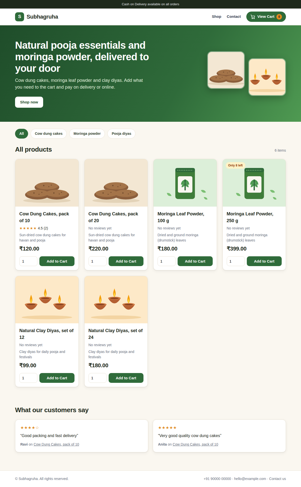
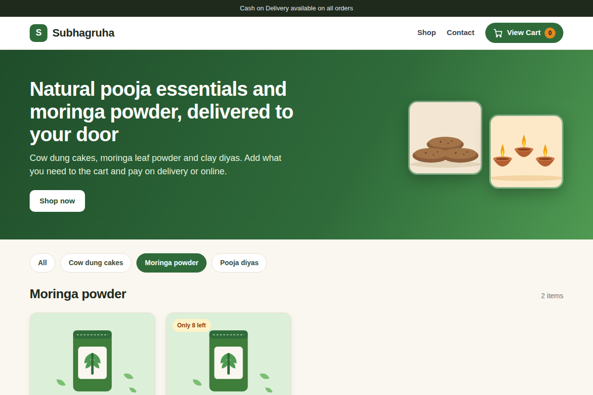
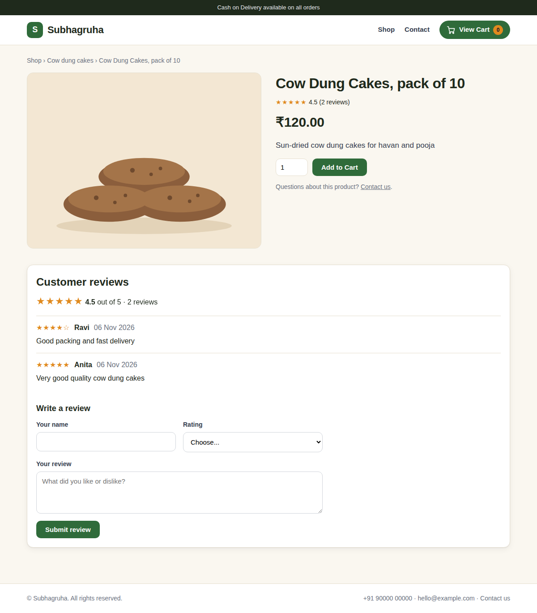
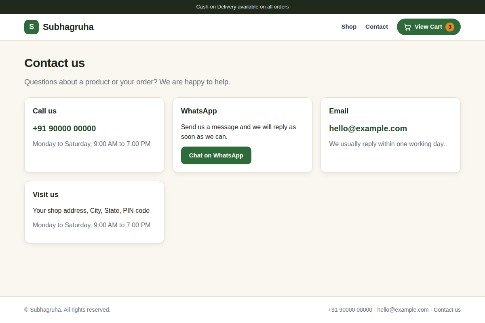
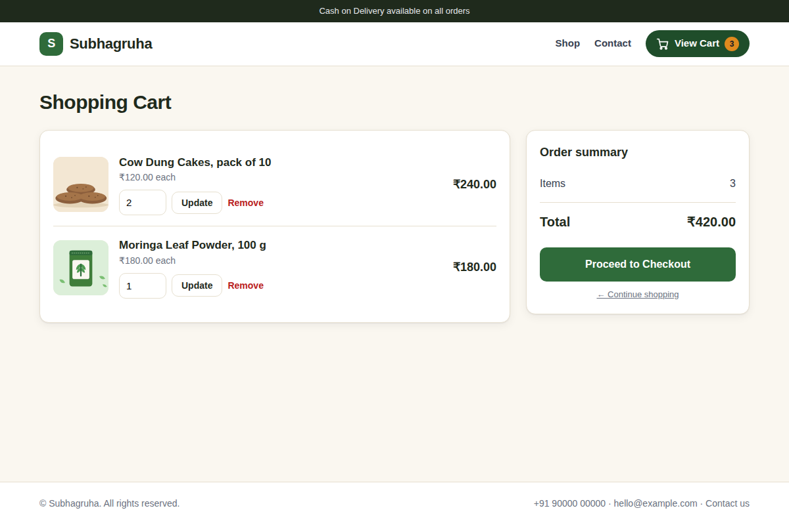
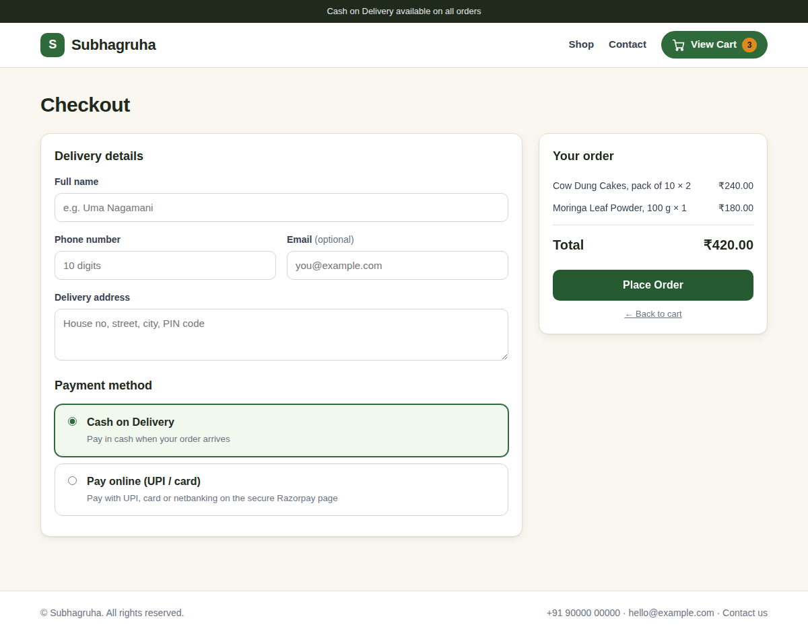
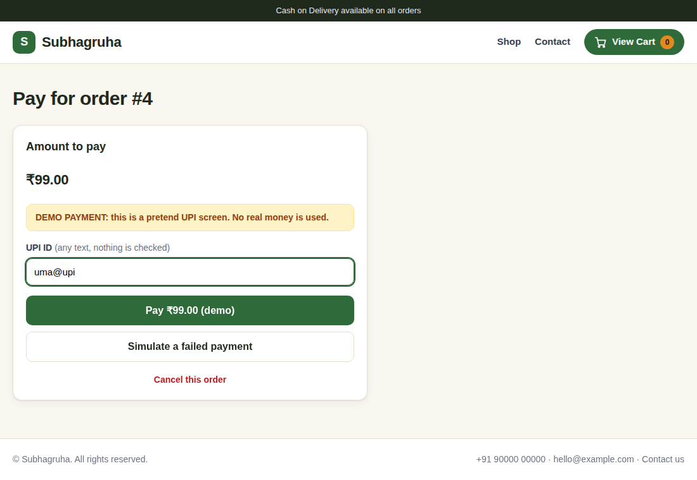
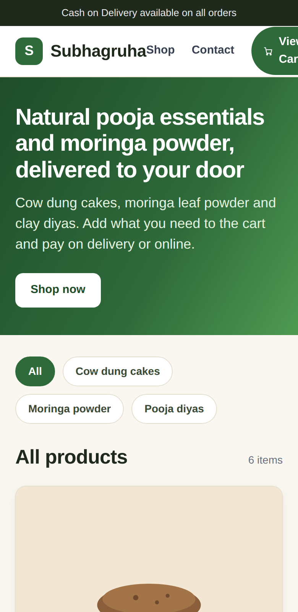

# Subhagruha: Java Servlet + JSP + MySQL shopping site

A small online shop built with **Java Servlets, JSP and MySQL** (MVC pattern).
Customers can browse products, filter by category, add items to a cart, open a separate cart page and
place an order. The order is saved in the database in one transaction.

The products are **sample data** (cow dung cakes, moringa leaf powder, clay pooja diyas) with sample prices.

## Screenshots
| Products | Category filter |
|---|---|
|  |  |

| Product page with customer reviews | Contact page |
|---|---|
|  |  |

| Cart page | Checkout |
|---|---|
|  |  |

Demo payment page (no account needed):



Works on phones too:



*The two reviews in the screenshots were entered as test data. Contact details are sample values.*

## Features
- Product page with pictures, prices and "Only 8 left" / "Out of stock" tags
- **Product detail page** with **customer reviews**: star ratings, average rating, and a "Write a review" form
  (server-side checks, one review per product per visit, a hidden spam-trap field, and reviews can be hidden by the owner)
- Star rating shown on every product card, and the newest reviews on the home page
- **Contact page** (call, WhatsApp, email, address, opening hours) and contact details in the footer
- The shop name and contact details are set in one file: `com/shop/util/ShopInfo.java`
- **Category filter** buttons (All, Cow dung cakes, Moringa powder, Pooja diyas)
- **Add to cart**, with a cart counter in the top bar
- **Separate cart page** (opened with "View Cart"): change quantity, remove items, see the total
- **Checkout** with server-side validation (name, 10-digit phone, email, address)
- Payment choice: Cash on Delivery, or **Pay online with Razorpay** (UPI, card, netbanking; test mode)
- **Demo payment screen** (pretend UPI page, no real money) when no payment keys are set, so the whole flow can be tried without any account
- Online payment is checked on the server: it creates the Razorpay order, verifies the payment signature (HMAC-SHA256), and only then marks the order **PAID**
- Unpaid online orders can be cancelled, and the stock is put back in one transaction
- Order saved with a **database transaction**: order, order items and stock update succeed together, or nothing is saved (rollback)
- Prices are always read from the database, so a customer cannot change a price in the browser
- User text is HTML-escaped; database access uses `PreparedStatement`
- Responsive layout (desktop and phone)

## Tech stack
Java, Servlets, JSP, JDBC, MySQL, Maven, Apache Tomcat 9, HTML, CSS

## Project structure (MVC)
| Layer | Files |
|---|---|
| View | `products.jsp`, `product.jsp`, `cart.jsp`, `checkout.jsp`, `pay.jsp`, `success.jsp`, `contact.jsp`, `header.jsp`, `footer.jsp`, `css/style.css` |
| Controller | `ProductServlet`, `ProductDetailServlet`, `ReviewServlet`, `CartServlet`, `CheckoutServlet`, `PayServlet`, `PaymentVerifyServlet`, `PaymentCancelServlet` |
| Model | `Product`, `Review`, `Order`, `Cart`, `CartItem` |
| Data access | `DBUtil`, `ProductDAO`, `ReviewDAO`, `OrderDAO`, `SchemaUpdater` |
| Database | `sql/database.sql` (tables `products`, `orders`, `order_items`, `reviews`) |

## How to run (Eclipse + Tomcat 9)
1. Install Java, MySQL and Apache Tomcat 9, and add Tomcat 9 as a server in Eclipse.
2. Run `sql/database.sql` in MySQL (creates the database `shopdb` and the sample products).
3. In Eclipse: **File > Import > General > Existing Projects into Workspace**, choose this folder, click **Finish**.
4. Open `src/main/java/com/shop/dao/DBUtil.java` and put your MySQL password in `PASSWORD`.
5. Right-click the project, choose **Run As > Run on Server**, pick Tomcat 9 and click **Finish**.
6. Open `http://localhost:8080/shop/products`.

The MySQL driver is already in `src/main/webapp/WEB-INF/lib`. The project also has a `pom.xml`,
so it can be imported as a Maven project instead (Tomcat 10 or newer needs `jakarta.servlet` instead of `javax.servlet`).

## Online payment
The shop has two modes for **Pay online**:

1. **Demo mode (default, nothing to set up).** With no Razorpay keys, the pay page shows a clearly labeled pretend UPI screen
   with a "Pay (demo)" button and a "Simulate a failed payment" button. No real money is used. It is switched on by
   `ALLOW_DEMO_PAYMENT = true` in `ShopInfo.java`. **Set it to `false` on a real shop**, so nobody can "pay" without paying.
   It stops working by itself as soon as real Razorpay keys are set.
2. **Real Razorpay payment.** Add your Razorpay keys (below) and the shop automatically uses Razorpay Checkout instead.

### Real payments with Razorpay (test mode)
1. Create a free account at razorpay.com and, in the dashboard, switch to **Test Mode** and generate **test API keys** (`rzp_test_...`).
2. Create a file named `razorpay.properties` in your **user folder** (for example `C:\Users\yourname`), **not** inside the project, with:
   ```
   key_id=rzp_test_xxxxxxxx
   key_secret=xxxxxxxxxxxxxxxx
   ```
   (`razorpay.properties.example` shows the format.) The keys can also be set as the environment variables `RAZORPAY_KEY_ID` and `RAZORPAY_KEY_SECRET`.
3. Older databases are upgraded automatically when the website starts (the reviews table and the payment columns are added if missing).
4. Restart Tomcat, choose **Pay online** at checkout, and pay with the test UPI id `success@razorpay` (use `failure@razorpay` to test a failed payment).

The keys are never stored in the code, so they cannot end up on GitHub by mistake.
Test mode moves no real money. Going live needs a Razorpay account with business KYC.

## What I learned
- Building an MVC web app: controller servlets, JSP views and DAO classes
- Keeping the cart in the user session
- Using JDBC transactions (`commit` and `rollback`) so an order is never half-saved
- Server-side validation and why the server must check prices and stock itself
- Responsive CSS for desktop and phone

## Ideas for next steps
Admin page for products and stock, customer login, a real payment gateway, product photo upload.

## Setting the shop name and contact details
Open `src/main/java/com/shop/util/ShopInfo.java` and change the name, phone, WhatsApp number, email, address and opening hours.
The header, footer, page titles, contact page and the Razorpay window all use these values.
The values are written as `String.valueOf("...")` on purpose, so that a normal server restart shows a changed value.

## Managing reviews
Reviews appear straight away. The owner can hide a review (for example spam) with `UPDATE reviews SET visible = 0 WHERE id = ...;`
(see `sql/manage_reviews.sql`). Only real customer reviews should be shown on a live shop.
